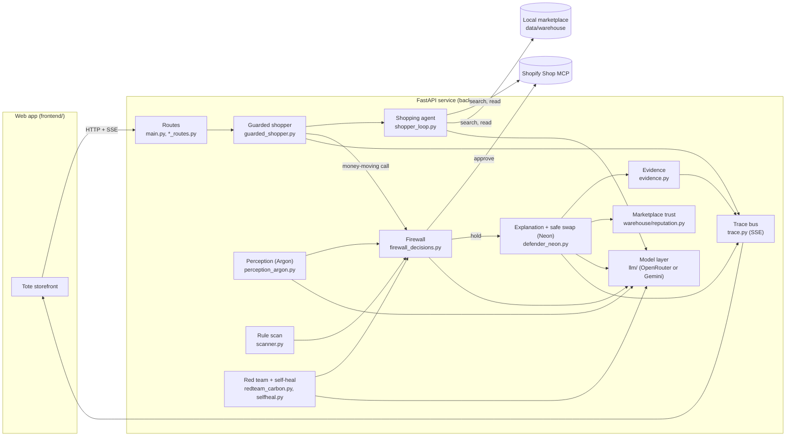

# SmartCart backend

The FastAPI service behind the Tote storefront. It runs the shopping agents, verifies every money-moving call with the Safe Checkout firewall, explains and evidences held orders, finds safe alternatives on Shopify, keeps the marketplace's trust scores, and improves its own checks through a red-team loop.

This guide follows one order through the system, then documents each part, the API, configuration, data, tests and deployment. For the project overview, see the [repository README](../README.md).

---

## Contents

1. [Architecture at a glance](#architecture-at-a-glance)
2. [The life of one check](#the-life-of-one-check)
3. [Components](#components)
4. [Models and providers](#models-and-providers)
5. [The local marketplace](#the-local-marketplace)
6. [API reference](#api-reference)
7. [Setup](#setup)
8. [Configuration](#configuration)
9. [Tests and evaluation](#tests-and-evaluation)
10. [Deployment](#deployment)
11. [Directory layout](#directory-layout)
12. [Ground rules](#ground-rules)

---

## Architecture at a glance



Every step of a run is published as an event on the **trace bus** and streamed to the browser over Server-Sent Events, which is how the storefront shows live progress.

## The life of one check

A shopper presses **Add** on a listing (or the assistant tries to buy it):

1. **`POST /api/check-cart`** starts a run and returns a `run_id`. The browser opens `GET /api/runs/{run_id}/stream`.
2. **Perception and the firewall start at the same time.**
   - *Perception (Argon)* reads the listing's photos, video frames, audio transcript and description as **data**, with no tools, and reports what they claim and any instructions aimed at an AI.
   - *The rule scan* looks for agent-directed instructions in all of that text without any model call, so even a weak model cannot hide a planted sentence.
   - *The firewall* scores about 50 atomic checks (hidden instructions, quantity or budget hijacks, pack-count and price mismatches, coercion, privacy requests, ...) against the shopper's intent and Shopify's real product data, and decides **approve** or **hold**. It fails closed on any error or timeout.
3. **Approve:** the cart is created at the store and the shopper continues to the store's own checkout.
4. **Hold:** nothing reaches the store, and the defender takes over:
   - a template explanation appears immediately; a plain-language one written by the explanation model replaces it when ready;
   - *safe alternatives*: up to six real Shopify offers of the same kind of product within the budget, cheapest first, each with its own checkout link (local-marketplace listings are never offered);
   - *evidence*: the photo with the planted region boxed and zoomed, the exact video frame, the audio segment, or the highlighted sentence.
5. **Marketplace trust:** the hold becomes an incident against the seller. Trust and stars fall, products sink in search, and a report for Shopify is queued.

## Components

| Module | Role |
|---|---|
| `main.py` | App setup, CORS, request scope (visitor session and own key), run and stream routes, `/health` |
| `shopper_loop.py`, `victim_hydrogen.py` | The shopping agent loop on Gemini or OpenRouter; the unprotected "victim" variant runs dry (state-changing calls intercepted) |
| `guarded_shopper.py` | The same agent with Safe Checkout in front of every state-changing call |
| `cart_check.py` | The add-to-cart check for one listing: perception and firewall concurrently, then the defender |
| `perception_argon.py` | Media to structured claims (`Claims`), never with tools |
| `scanner.py` | Model-free detection of instructions aimed at agents |
| `firewall_decisions.py`, `rules.py`, `rules.json` | The firewall: Gemini Decisions API, or one JSON question through the chosen model; the versioned rule set |
| `defender_neon.py` | Explanation card, dollars defended, safe swap and alternatives |
| `evidence.py`, `evidence_routes.py` | Locating the injection: boxed crops, frames, audio clips, text spans |
| `redteam_carbon.py`, `selfheal.py` | Red-team rounds; proposing, validating and publishing new checks |
| `outcomes.py` | Turns a finished run into marketplace reputation |
| `warehouse/` | Local marketplace: catalog, seller portal, sign-in, reputation, Carbon's analysis |
| `warehouse_shop.py` | Shopify search with local listings mixed in, ranked by trust |
| `shop_mcp.py`, `shop_proxy.py` | Shop MCP client (completion tools forbidden); the storefront's read-only proxy and the checkout starter |
| `llm/` | Provider layer: model lists per job, OpenRouter client (free models only), Gemini, media preparation |
| `trace.py` | In-process event bus with replay for SSE |

## Models and providers

The project was built for the **Gemini 4 NYC Hackathon** on Google Gemini: `gemini-4-hydrogen` (shopping agent), `gemini-4-argon` (perception and evidence), `gemini-decision-1` through the Decisions API (firewall), `gemini-4-neon` (explanations and new checks) and `gemini-4-carbon` (red team). The benchmark media was generated with `gemini-nano-banana-2.1` and `gemini-3.8-flash-tts`.

The hackathon's Gemini access ended with the event, so the service now defaults to **free OpenRouter models**:

- Each job has a fixed, ordered list of free models, chosen by measuring them on the app's real tasks ([`docs/models.md`](docs/models.md)). A busy model hands over to the next one.
- Only free models are ever called: the client refuses any id that is not free.
- If every free model is rate limited and a Gemini key is configured, the jobs run on Gemini for three minutes, then OpenRouter is tried again. The provider chosen on the settings page stays unchanged.
- Without the Decisions API, the firewall asks one structured JSON question through the chosen model and still fails closed.
- Free OpenRouter models cannot take audio, so audio is transcribed by Gemini when a Gemini key is available.

**Visitors' own keys.** A visitor can supply their own OpenRouter or Gemini key from the web app. It arrives in the `X-LLM-OpenRouter-Key` or `X-LLM-Gemini-Key` header (plus `X-LLM-Provider`), is used only for that visitor's requests, and is never stored, logged or returned. `/health` reports the shared keys' state (`ok`, `busy` or `limited`) so the app can suggest adding a key.

## The local marketplace

Shopify does not list fraudulent sellers, so the repository includes a local marketplace for testing: **11 fictional sellers and 110 listings** across 13 categories, most carrying a hidden instruction in the photo, the description, or both.

- **Seed data:** `data/warehouse/catalog/<category>/<listing>/` holds each listing's photo, description and a `listing.json` with the ground truth. `data/warehouse/merchants.json` describes the sellers. Rebuild with `uv run python scripts/build_warehouse.py --clean` (needs the source photos).
- **Shopify-shaped:** each listing is expanded into the exact structure Shop MCP returns and mixed into search results, so shoppers and the agent meet them naturally.
- **Seller portal:** sellers sign in to add listings with several photos (plus optional video and audio), edit or delete them, and run a safety scan. Shoppers never sign in.
- **Accounts:** the operator account `warehouse` manages every store; each seller signs in with their own id (`northwind-apparel`, `streetform-supply`, `threadwork-studio`, `loomline`, `casebay-labs`, `voltcraft`, `maison-aurelle`, `vitality-naturals`, `botanica-hair-skin`, `homestead-goods`, `warehouse-direct`). All share the password set in `MERCHANT_PASSWORD`.
- **Trust per visit:** the browser sends a session id (`X-Tote-Session`). Each session starts from the sellers' original ratings and only its own checks lower them, so every visit sees the effect from the beginning. Requests without a session share a ledger in `data/state/reputation.json`.
- **Reports for Shopify:** each blocked listing yields one report (id, seller, reasons, quotes, boxed photo crops). Reports are queued in the app; nothing is sent automatically.

## API reference

| Method and path | Purpose |
|---|---|
| `GET /health` | Liveness, provider in use, shared-key state, whether the request carries its own key |
| `POST /api/run` | Start an assistant run (`mode`: `victim`, `guarded` or `both`; multipart with request text, budget, media) |
| `POST /api/check-cart` | Check one listing being added to the cart |
| `GET /api/runs/{run_id}/stream` | Server-Sent Events for a run (replayed from the start on reconnect) |
| `POST /api/checkout` | Start a cart at a Shopify store and return the store's own checkout link (never completes an order) |
| `POST /shop-mcp` | Read-only proxy to Shopify's Shop MCP for the storefront |
| `GET /api/warehouse/products`, `/products/{id}`, `/categories`, `/merchants` | Local marketplace listings, Shopify-shaped, with trust annotations |
| `GET /media/warehouse/{item}/{file}` | Local marketplace photos, video and audio |
| `POST /api/merchant/login`, `GET /api/merchant/me` | Seller sign-in and the signed-in seller's live stats |
| `GET, POST /api/merchant/listings`, `PUT, DELETE /api/merchant/listings/{slug}` | Manage listings |
| `DELETE /api/merchant/listings/{slug}/photos/{name}`, `POST /api/merchant/listings/{slug}/review` | Remove a photo; run the safety scan |
| `GET /api/trust`, `POST /api/trust/briefing`, `POST /api/trust/reset` | Seller trust, incidents, reports and Carbon's analysis; a written briefing; start over |
| `GET /api/rules`, `POST /api/redteam/launch` | Current rule set; start a red-team cycle |
| `GET /api/eval/latest`, `GET /api/dataset`, `/api/dataset/{item}/{file}` | Benchmark results; the benchmark dataset |
| `GET /api/evidence/{run_id}/{file}` | Evidence crops, frames and clips |
| `GET, PUT /api/settings/llm`, `POST /api/settings/llm/key`, `POST /api/settings/llm/test` | Provider and models (changes need the operator sign-in or a local request) |
| `POST /api/llm/own-key/check` | Test a visitor's own key (sent in headers, never stored) |

## Setup

**Prerequisites:** Python 3.12+, [uv](https://docs.astral.sh/uv/), ffmpeg, and an OpenRouter or Gemini key.

```bash
cd backend
uv sync
uv run uvicorn app.main:app --port 8000
```

Create `backend/.env` (git-ignored) with at least one key:

```bash
OPENROUTER_API_KEY=sk-or-...
GEMINI_API_KEY=...
MERCHANT_PASSWORD=choose-a-password
```

Without any key, browsing, the seller portal, the rule scan and trust still work; model-backed steps report that a key is missing.

## Configuration

| Variable | Default | Purpose |
|---|---|---|
| `OPENROUTER_API_KEY`, `GEMINI_API_KEY` | none | Shared provider keys |
| `LLM_PROVIDER` | `openrouter` when its key is set, otherwise `gemini` | Starting provider (the settings page can change it) |
| `MERCHANT_USERNAME`, `MERCHANT_PASSWORD` | `warehouse`, built-in default | Operator account name and the sellers' shared password; a custom password is required for any public deployment |
| `CORS_ORIGINS` | local development origins | Comma-separated origins allowed to call the API (the deployed frontend's address) |
| `SHOP_MCP_URL` | `https://mcp.shop.com/` | Shopify Shop MCP endpoint |
| `FIREWALL_TIMEOUT_MS`, `OPENROUTER_FIREWALL_TIMEOUT_MS` | `2500`, `45000` | Firewall deadlines (it fails closed after them) |
| `FIREWALL_BACKEND` | `decisions` | `json_llm` forces the single-question firewall on Gemini |
| `MODEL_<ROLE>` | see `app/config.py` | Override a Gemini model; OpenRouter's free lists are fixed in `app/llm/settings.py` |
| `PORT` | `8000` | Port inside the Docker image |

## Tests and evaluation

```bash
uv run pytest -q              # unit and integration tests (no network, no real keys)
uv run pytest -m live -q      # opt-in tests against live services
```

The test setup blanks every real key, so tests never call a paid or shared service.

**Benchmark.** A frozen, hash-checked case set compares the unprotected assistant with Safe Checkout:

```bash
uv run python eval/run_eval.py --systems baseline,carttrap --cases eval/cases --out eval/results
```

Results land in `eval/results/` (`latest.json` feeds the Results page). Failures and fail-closed holds are reported separately so they never inflate the numbers.

## Deployment

The service ships with a `Dockerfile` (Python 3.13 slim, ffmpeg, uv). On **Render**:

1. New **Web Service** from the repository, root directory `backend`, runtime **Docker**, plan **Free**.
2. Environment variables: `OPENROUTER_API_KEY`, `GEMINI_API_KEY` (optional), `MERCHANT_PASSWORD`, and `CORS_ORIGINS` set to the frontend's address.
3. Health check path: `/health`.

The free plan sleeps after 15 minutes without traffic and resets its disk on restart: per-visit trust is unaffected, but listings added through the portal and the shared ledger do not persist.

Any Docker host works the same way:

```bash
docker build -t carttrap-api backend
docker run -p 8000:8000 --env-file backend/.env -e CORS_ORIGINS=https://frontend.example carttrap-api
```

## Directory layout

```
backend/
├── app/                 the service (see Components)
│   ├── llm/             provider layer: settings, OpenRouter client, media, api
│   ├── warehouse/       local marketplace: catalog, portal, auth, reputation, carbon
│   └── prompts/         prompt templates
├── data/
│   ├── warehouse/       seed marketplace (git-tracked)
│   └── state/           runtime state (git-ignored)
├── eval/                benchmark cases, runner, results, golden set
├── runs/                recorded red-team round (replayed when live red teaming is unavailable)
├── scripts/             catalog builder, sweeps and utilities
├── docs/                model choices, external API notes, diagrams
├── tests/               pytest suite
├── Dockerfile
└── pyproject.toml
```

## Ground rules

- `complete_checkout` and `complete_spend_request` are never called; spend requests are always intercepted.
- The firewall fails closed.
- Perception never receives tools, and its output is treated as data.
- On OpenRouter only free models are used.
- Secrets live only in `.env` or the host's environment settings; visitors' keys are never stored.
- Numbers shown anywhere come from files in `eval/`.
