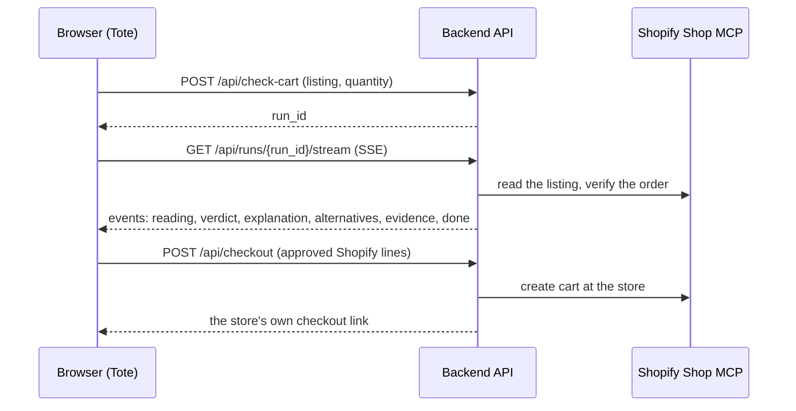

# Tote web app (SmartCart frontend)

The storefront where shoppers browse real Shopify products, let an AI assistant shop for them, and see **Safe Checkout** verify every order. Built with Vite, React 19, TypeScript, Tailwind CSS v4 and GSAP. It talks to the [backend](../backend/README.md) only over HTTP, so it builds and deploys on its own.

For the project overview, see the [repository README](../README.md).

---

## Contents

1. [Pages](#pages)
2. [How the app talks to the backend](#how-the-app-talks-to-the-backend)
3. [What a shopper sees during a check](#what-a-shopper-sees-during-a-check)
4. [Setup](#setup)
5. [Build and deploy](#build-and-deploy)
6. [Source layout](#source-layout)
7. [Quality checks](#quality-checks)
8. [Design notes](#design-notes)

---

## Pages

Every page has its own address, so any of them can be bookmarked or shared. Older `#/page` links still open the right page.

| Address | Page | What it is for |
|---|---|---|
| `/` | Home | Entry point: search, or hand the shopping to the assistant |
| `/shop` | Shop | Search Shopify with local-marketplace listings mixed in; add to cart with a live Safe Checkout check; the cart and the store checkout |
| `/product/<id>` | Product | Gallery, options, seller trust, Add to cart with live progress, and the full review when an order is held |
| `/assistant` | Assistant | The AI assistant shopping on its own, without protection, to show what can go wrong |
| `/safe-checkout` | Safe Checkout | The same assistant with every order verified first |
| `/compare` | Compare | Both assistants side by side on the same request |
| `/trust` | Marketplace trust | Seller trust and star ratings, incidents, reports for Shopify, and the analyst's briefing |
| `/sell` | Sell | Seller sign-in and portal: listings, photos, live rating and flagged photos |
| `/safety-updates` | Safety updates | Red-team rounds and the new checks they produce |
| `/results` | Results | Benchmark results: unprotected assistant vs. Safe Checkout |
| `/dataset` | Dataset | The poisoned and clean benchmark items |
| `/settings` | AI models and keys | Which models run each job, and adding a personal OpenRouter or Gemini key |

Shop, Assistant and Safe Checkout sit in the main navigation (keys `1`, `2`, `3`); the rest are under **More**. On phones the same pages are in the bottom bar and the **More** sheet.

## How the app talks to the backend



- **API base:** `VITE_API_URL` (no trailing slash) is the backend's address. It is empty in development, where Vite forwards `/api`, `/media`, `/health` and `/shop-mcp` to `http://localhost:8000`.
- **Live runs:** a run's events arrive over Server-Sent Events and are folded into one state object (`src/state.ts`), which every view renders.
- **Session:** each browser tab sends a session id (`X-Tote-Session`), so marketplace ratings start fresh for every visit and change only with that visit's own checks.
- **Own key:** if the visitor adds an OpenRouter or Gemini key, it is kept in the browser (this tab, or this device if chosen) and sent only to this app's API with that visitor's requests (`X-LLM-*` headers). It never goes anywhere else.
- **Shopify:** catalog reads go through the backend's read-only `/shop-mcp` proxy; checkout goes through `/api/checkout`, which returns the store's own checkout page.

## What a shopper sees during a check

1. **Live progress:** a checklist driven by real events: reading the photos and description, checking the order, the decision, then (for a held order) finding safe alternatives, pinpointing the hidden text and writing the explanation, with elapsed time.
2. **The review:** the amount protected, the evidence (photo with the region boxed and zoomed, video frame, audio clip, or highlighted sentence), a plain-language summary, the text found in the listing, and the checks that fired.
3. **Safe alternatives:** a carousel of real Shopify offers within budget, each with photo, store, rating, price and its own **Check out** button.
4. **Consequences:** the seller's rating and trust drop immediately, and the listing's report for Shopify appears on the review, the Trust page and the seller's portal.
5. **Limits:** if the shared AI quota is used up, a banner explains it and offers to add a personal key.

## Setup

**Prerequisites:** Node.js 22+ and the backend running on port 8000 (see the [backend guide](../backend/README.md)).

```bash
cd frontend
npm install
npm run dev          # http://localhost:5173
```

## Build and deploy

```bash
VITE_API_URL=https://backend.example npm run build    # static files in dist/
```

**Cloudflare Pages:**

| Setting | Value |
|---|---|
| Root directory | `frontend` |
| Build command | `npm run build` |
| Output directory | `dist` |
| Environment variable | `VITE_API_URL` = the backend's address |

`public/_redirects` sends every address to the app, so `/results` and the other pages load directly. The backend must list this site's address in its `CORS_ORIGINS`.

## Source layout

```
src/
├── main.tsx, App.tsx       entry point, page routing (clean addresses), app shell
├── config.ts               API base (apiUrl, assetUrl), endpoints, example requests
├── api.ts, shop.ts         runs and streams, health and limits; Shopify proxy client and checkout
├── state.ts, types.ts      the run state built from streamed events; shared types
├── catalog.ts              search and product details: Shopify results with marketplace listings mixed in by trust
├── components/             pages and building blocks
│   ├── Home, ShopYourself, ProductPage, AgentPage, Arena
│   ├── FraudCard, SafeCart, Evidence, CheckProgress     the held-order review
│   ├── Trust, TrustBadge, Sell                         marketplace trust and the seller portal
│   ├── RedTeam, Scoreboard, Dataset, Settings, OwnKey
│   └── Header, ui                                      navigation and shared UI
├── hooks/                  cart, cart checker, agent runs, backend health, theme, model labels
├── lib/                    marketplace client, session and own-key headers, progress stages, formatting
└── fixtures/               recorded runs for replay mode
```

Nothing in this folder imports from `../backend`.

## Quality checks

```bash
npx tsc -b --noEmit      # types
npx vitest run           # unit tests (on Windows, run from an uppercase drive path such as E:\...)
npm run build            # production build
```

## Design notes

- **Responsive by default:** layouts are checked at phone (360 px), tablet (768 px), laptop (1280 px) and wide (1920 px) widths with no horizontal overflow; phones get a bottom navigation bar and bottom-sheet dialogs.
- **Accessible:** one page heading per page, labelled controls and images, keyboard navigation, visible focus, live regions for progress and results, and reduced motion honoured.
- **One typeface:** Inter throughout with tabular figures for numbers; monospace only for code and keys.
- **Light and dark themes**, following the system setting by default.
